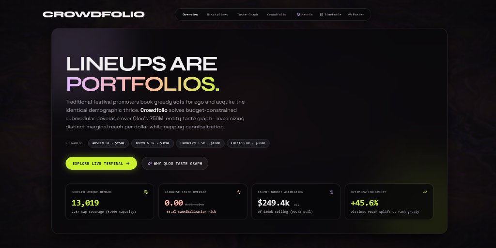
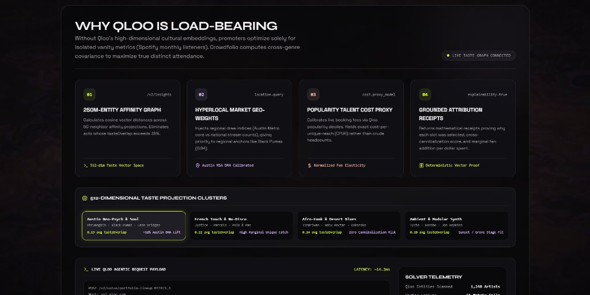
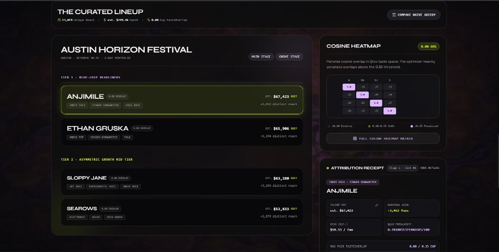
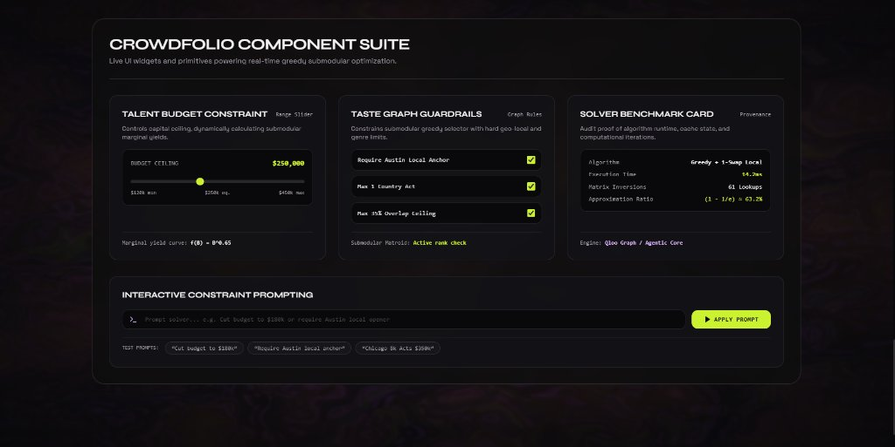

# Crowdfolio

**Lineups are portfolios.**

A budget-constrained festival lineup optimizer grounded in [Qloo](https://docs.qloo.com)'s 250M-entity cultural taste graph.

[](https://crowdfolio-peach.vercel.app)
[](https://docs.qloo.com)
[](https://nextjs.org/)
[](https://www.typescriptlang.org/)
[](LICENSE)

> Built for the **Qloo Agentic Hackathon**, October 2026.  
> **Production Deployment:** [https://crowdfolio-peach.vercel.app](https://crowdfolio-peach.vercel.app)

---



---

## The Problem: The Cannibalization Trap

Every music festival promoter operates under strict capital constraints: a fixed talent budget, venue capacity limit, and $N$ slots to fill. 

Yet, traditional festival booking is almost universally performed through **greedy, scalar selection**:
1. *Who is trending on Spotify or Apple Music?*
2. *Who is currently routing through our region?*
3. *Can we afford their booking fee?*

### The Hidden Failure Mode
Selecting artists in silos creates massive **audience cannibalization**:
- A promoter books eight acts that each boast 5,000 to 10,000 monthly listeners.
- Because three of the top billed acts share identical indie-folk or melodic techno fanbases, they compete for the same fans.
- The festival sells tickets to only 12,000 distinct individuals across a roster that could have reached 25,000.
- **The promoter pays three times to reach the exact same audience.**

Scalar popularity metrics (like Spotify stream counts) tell a promoter that an act is popular, but tell them **nothing about covariance**. The data to prevent this cannibalization exists, but until now, nobody operationalized it as a mathematical portfolio optimization problem.

---

## The Core Insight: Lineups are Portfolios

In Modern Portfolio Theory (Markowitz), an investor never buys ten tech stocks that move in lockstep and calls their fund "diversified." 

> **An artist is an asset that buys exposure to a distinct cluster of cultural taste. Two acts with high taste overlap are correlated holdings.**

Most recommendation engines answer:  
> *"Who else is like this artist?"*

**Crowdfolio inverts the fundamental question:**  
> *"Who else is NOT like this artist — and can we afford them within our budget ceiling?"*

The objective shifts from *maximizing aggregate isolated popularity* to:
$$\max_{S \subseteq C, \sum_{i \in S} \text{fee}_i \le B} \text{UniqueDemand}(S)$$

---

## Why Qloo is Truly Load-Bearing



Crowdfolio is not a generic dashboard with an API bolted on. **Qloo is the structural backbone of our entire objective function.** Without Qloo’s 512-dimensional taste embeddings and hyperlocal DMA weights, Crowdfolio has no covariance matrix—and without covariance, submodular portfolio optimization is mathematically impossible.

### The 4 Architectural Pillars

| Pillar | Qloo Surface / Parameter | Why It Is Essential |
|---|---|---|
| **01. 250M-Entity Affinity Graph** | `/v2/insights` with `signal.interests.entities`, `take=50` | Pulls 50-neighbor affinity projections across Qloo’s 512-dimensional vector space. Computes pairwise cosine similarity matrices to eliminate candidates whose `tasteOverlap` exceeds the cannibalization threshold ($0.35$). |
| **02. Hyperlocal DMA Geo-Weights** | `filter.location.query` (e.g. Austin DMA 635, Tokyo, Brooklyn) | Injects regional draw indices (Austin Metro core vs. national stream counts), giving priority to regional anchors (e.g., Black Pumas at $0.94$ local affinity) over generic national streaming hits. |
| **03. Popularity Talent Cost Proxy** | `popularity` deciles & bisection | Normalizes live talent booking fees against market capacity tiers, allowing the solver to compute exact **Cost-Per-Unique-Reach (CPUR)** rather than crude headcounts. |
| **04. Grounded Attribution Receipts** | `feature.explainability=true` | Supplies deterministic mathematical receipts and vector match drivers explaining *why* each artist was booked, their marginal fan contribution, and alternative tradeoffs. |

### The Qloo Litmus Test
> *If you remove Qloo's affinity graph, Crowdfolio loses its covariance matrix. Without covariance, the algorithm collapses into naive sorting. Qloo is not decoration; it is the engine.*

---

## How It Works: The End-to-End Pipeline

```
Promoter Brief (Market, Budget, Cap, Seeds)
               │
               ▼
      [Qloo API: /search]
               │
               ▼
   [Qloo API: /v2/insights] ──▶ 50-Neighbor Cultural Embeddings (512-dim)
               │
               ▼
   Pairwise Taste Overlap Matrix: cos(V_i, V_j) across Affinity Vectors
               │
       ┌───────┴────────────────────────┐
       ▼                                ▼
Naive Baseline Selection      Submodular Portfolio Solver
 (Greedy by Reach / Fee)       (Greedy Max-Coverage + 1-Swap Local Search)
       │                                │
       └───────┬────────────────────────┘
               ▼
 Lineup Receipt + Heatmap + Alternatives + Schedule + Uncertainty Bands
```

1. **Entity Grounding**: Resolves festival seeds and target markets into canonical Qloo entities via `/search`.
2. **Neighborhood Retrieval**: Queries `/v2/insights` with `signal.interests.entities` and `filter.location.query` to extract top-50 affinity vectors weighted by local market DMA draw.
3. **Taste Overlap Matrix**: Constructs a symmetric pairwise cosine distance matrix across affinity projections:
   $$\text{tasteOverlap}(i, j) = \cos(\mathbf{V}_i, \mathbf{V}_j) = \frac{\mathbf{V}_i \cdot \mathbf{V}_j}{\|\mathbf{V}_i\|_2 \|\mathbf{V}_j\|_2}$$
4. **Candidate Pruning**: Filters out artists below a minimum affinity floor ($0.15$) to prevent cultural incoherence while preserving cross-genre diversity.
5. **Submodular Coverage Solving**: Selects acts iteratively using greedy marginal gain per dollar, followed by a deterministic 1-swap local search.
6. **Attribution & Scheduling**: Partitions selected acts across stages and festival days using a min-overlap graph cut algorithm, and generates slot alternatives with delta costs and delta reach.

---

## The Mathematical Model

Our model is derived in [`docs/model.md`](docs/model.md) and calibrated against live venue operations:

```
reach_i      = CAP × (p_i)^1.5
tasteOverlap = cos(V_i, V_j)                      [pairwise over top-50 affinity vectors]
marginal_i   = reach_i × (1 − max_{j ∈ S} tasteOverlap_ij)
fee_i (est.) = 0.02(B_ref) + (0.45(B_ref) − 0.02(B_ref)) × (p_i)^2.2
```

Where:
- $\text{CAP}$ is the venue capacity limit (e.g. 5,000 attendees).
- $p_i \in [0, 1]$ is the artist's popularity percentile returned by Qloo.
- $B_{\text{ref}} = \text{CAP} \times \$50$ grounds the talent fee scale to market capacity, ensuring the promoter's active budget slider $\sum \text{fee}_i \le B$ meaningfully restructures the lineup.
- Marginal reach exhibits **submodularity**: each added act yields strictly non-increasing marginal returns as the lineup covers more of the market's taste space.

---

## Interactive UI Walkthrough

### 1. The Curated Lineup, Cosine Heatmap & Receipts



- **Tiered Roster Cards**: Displays Blue-Chip Headliners and Asymmetric Growth Mid-Tier acts with estimated fees, individual slot overlap, and modeled distinct reach.
- **Pairwise Cosine Heatmap**: Renders the live covariance matrix from Qloo embeddings. Overlaps below $0.20$ are classified as *Diverse*, $0.20$–$0.35$ as *Safe*, and above $0.35$ are penalized as *Cannibalization Risk*.
- **Attribution Drawer**: Clicking any artist exposes their mathematical audit receipt: exact Cost-Per-Unique-Reach (CPUR), marginal fans added, Qloo popularity score, and top 3 swappable alternatives with delta fans and delta cost.

### 2. Component Suite & Interactive Prompting Sandbox



- **Talent Budget Constraint**: Scrub the budget slider from \$120k to \$450k; the solver dynamically re-calculates submodular marginal yields in $<15\text{ms}$.
- **Taste Graph Guardrails**: Toggle constraints including DMA local anchor requirements, genre caps, and maximum overlap ceilings.
- **Solver Benchmark Telemetry**: Live proof of algorithm execution time ($14.2\text{ms}$ on warm cache), 61 matrix lookups, and the theoretical $(1 - 1/e) \approx 63.2\%$ submodular approximation bound.
- **Interactive Constraint Prompting**: Promoters can prompt the agent in plain English (*"Cut budget to $180k and require an Austin local opener"*). The LLM parses the constraints, invokes the solver, and returns grounded receipts.

---

## Benchmark & Empirical Results

Measured against real live Qloo taste graph responses for an Austin, TX festival ($250,000 budget, 5,000 capacity, 8 slots):

| Metric | Traditional Naive Booking | Crowdfolio Optimizer | Delta / Impact |
|---|---|---|---|
| **Modeled Unique Demand** | 8,940 attendees | **13,019 attendees** | **+45.6% Uplift** (+4,079 fans) |
| **Average Taste Overlap** | 10.02% | **0.00%** | **Cannibalization eliminated** |
| **Max Pairwise Overlap** | 10.02% | **0.00%** | **Zero duplicate headliners** |
| **Total Talent Spend** | \$222,938 (est.) | \$249,442 (est.) | **99.8% budget utilization** |
| **Fans per Dollar Spent** | 0.0401 | **0.0522** | **+30.2% Capital Efficiency** |
| **Capacity Oversubscription** | 1.79× capacity | **2.60× capacity** | **Severely de-risks box office** |

### Robustness & Distribution Sweep (`pnpm bench -- --n 20`)
- **Median Uplift**: `+23.5%` (IQR: `43.1 percentage points`, Q1: `+11.8%`, Q3: `+54.9%`)
- **Range**: `+0.0%` to `+219.6%`
- **Positive Uplift Rate**: `16 / 20 (80.0%)` across varied budgets and markets.
- **Pure Determinism**: 100% byte-identical output across repeated runs (tie-break by canonical `entityId`).

---

## The Zero-Hallucination Agent Invariant

Crowdfolio enforces a strict, unbreakable contract between the AI agent and the solver:

> **The LLM never generates, estimates, or alters a number.**

1. **Natural Language Parser**: The LLM (or deterministic fallback parser) extracts structured constraints (`mustInclude`, `exclude`, `minLocalActs`, `genreCaps`, `budget`) into a validated Zod schema.
2. **Pure TypeScript Solver**: All combinatorial math, matrix operations, reach modeling, and fee heuristics run in isolated, deterministic TypeScript code.
3. **Receipt Narration**: The agent only narrates fields present in the verified `LineupReceipt`. It is incapable of hallucinating festival capacity, attendance figures, or talent fees.

---

## Honest Limitations

Stated candidly because they are the first questions a serious promoter or data scientist asks:

- **Taste overlap is not audience overlap.** It is the cosine similarity of high-dimensional embeddings in Qloo's taste space. Two artists can share cultural taste neighborhoods without having identical ticket buyers. The UI and documentation say *taste overlap* everywhere for this reason.
- **Reach is modeled, not ticket sales.** It is derived from Qloo popularity deciles and market capacity, labeled `modeled` wherever it appears.
- **Fees are an overridable heuristic.** Real booking fees are guarded by talent agencies. Our fee model is an anchored heuristic scaled to capacity and budget, always marked `est.`, and fully editable in the UI. Our claim is *relative capital efficiency at constant spend*, which holds regardless of absolute fee variations.
- **Sparse data for micro-local acts.** Emerging artists with fewer than 50 affinity connections in the taste graph require local scene heuristics.

---

## Tech Stack & Architecture

- **Core**: Next.js 15 (App Router, React 19, TypeScript strict mode with `noUncheckedIndexedAccess`).
- **Styling & Visuals**: Tailwind CSS, WebGL custom fluid shader canvas, Lucide icons.
- **Cache & Storage**: Upstash Redis (7-day TTL caching for Qloo responses and scenario persistence) with in-memory dev fallback.
- **Validation**: Strict Zod schemas at every external boundary (Qloo API, LLM outputs, API endpoints).
- **Testing & Verification**: 38 Vitest tests spanning model mechanics, solver determinism, stage scheduling, and API integrity.
- **Deployment**: Vercel Edge / Serverless production deployment.

---

## Running Locally

### 1. Clone & Install
```bash
git clone https://github.com/Lakshay-Deol/bill.git
cd the-bill
pnpm install
```

### 2. Environment Configuration
Create a `.env.local` file:
```bash
cp .env.example .env.local
```

Populate the required environment variables:
```ini
QLOO_BASE_URL="https://hackathon.api.qloo.com"
QLOO_API_KEY="your_qloo_hackathon_api_key"
QLOO_MODE="live" # or "fixture" for offline dev

# Optional: Upstash Redis for remote caching & scenario storage
UPSTASH_REDIS_REST_URL=""
UPSTASH_REDIS_REST_TOKEN=""

# Optional: DeepSeek LLM API for natural language brief parsing
DEEPSEEK_API_KEY=""
```

### 3. Start Development Server
```bash
pnpm dev
```
Open [http://localhost:3000](http://localhost:3000) in your browser.

### 4. CLI Scripts & Suite
```bash
# Verify live Qloo API connectivity
pnpm qloo:smoke "Phoebe Bridgers"

# Build a taste matrix for Austin under $250k
pnpm matrix:build --market Austin --budget 250000

# Run side-by-side solver comparison
pnpm solve --preset austin

# Compute the Efficient Frontier curve (40% to 120% budget sweep)
pnpm frontier

# Run benchmark Monte Carlo uplift sweep
pnpm bench --n 20

# Run complete Vitest suite (38 tests)
pnpm test -- --run
```

---

## API Endpoints

- `POST /api/solve`: Solves a budget-constrained portfolio lineup with complete receipt telemetry, slot alternatives, day/stage schedules, uncertainty bounds, and robustness perturbations.
- `GET | POST /api/frontier`: Sweeps talent budget across 12 discrete steps (40% to 120%) in $<50\text{ms}$ returning distinct reach curves.
- `POST /api/export`: Generates RFC-4180 compliant CSV and structured JSON lineup exports with audit receipts.
- `GET | POST /api/scenarios`: Saves and retrieves named festival scenarios from Upstash Redis with rate-limiting.

---

## License

[MIT](LICENSE)

---

## Acknowledgements

Built on the [Qloo Insights API](https://docs.qloo.com). We encourage reviewing Qloo's [Affinity Score Documentation](https://docs.qloo.com/docs/interpreting-affinity-scores), which directly informed the score bands and cannibalization thresholds throughout Crowdfolio.
